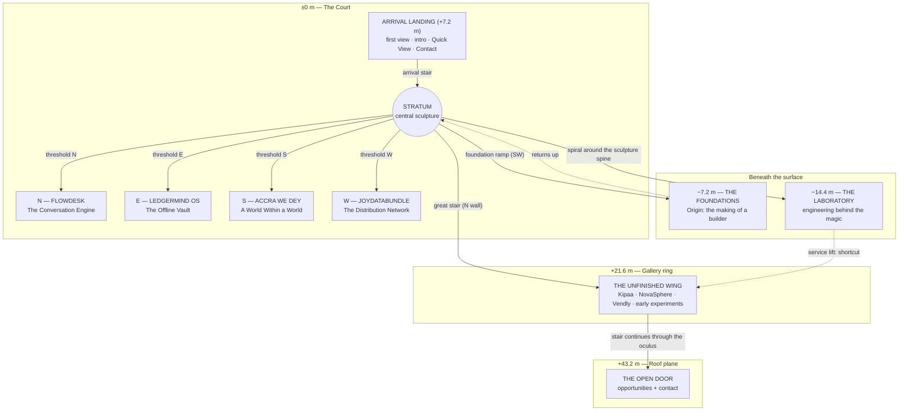

# B. Architectural Master Plan

**Units:** metres. **Module:** 1.2 m. **Bay:** 3.6 m. **Eye height:** 1.6 m.

**Labels**
- **[V]** verified in Phase 0.
- **[A]** assumption.
- **[R]** recommendation.
- **[F]** needs founder input.

---

## 1. Connected building or impossible sequence?

| Option | Description | Strengths | Weaknesses |
|---|---|---|---|
| **1. One continuous building** | Every room physically adjacent, walkable end to end | Highest coherence; strong sense of place | Huge streaming problem: long sightlines force loading many rooms at once. Every room must fit a real plan, which limits the exhibits |
| **2. Sequence of impossible spaces** | Disconnected rooms joined by portals or cuts | Easy streaming; every exhibit can be any size | Feels like separate demos; weak orientation; "video game levels" |
| **3. Coherent hub, impossible thresholds** [R] | A physically believable **Court** with four wings, a basement and a roof. Each wing is entered through a deep wall **threshold** whose far side is a self-contained world, larger than the wall could hold | Coherent and orientable: the Court is always "home". Thresholds give natural **loading boundaries** and occlusion. Exhibits keep freedom of scale. The impossibility is meaningful, not arbitrary | Thresholds must be designed carefully so they feel intentional, not like loading doors |

**Recommendation: Option 3.**
- **Plan logic:** the courtyard compound (Creative Direction §4, reference 1).
- **Streaming:** every threshold is a 6 m-deep wall passage with a 90° dog-leg. The next room loads while the visitor walks the passage, and neither room is visible from the other.

## 2. Overall layout

```
                       N
          ┌──────────────────────────┐
          │      FLOWDESK WING       │  "The Conversation Hall"
          └────────────┬─────────────┘
                 threshold N
┌───────────┐   ┌──────┴──────┐   ┌───────────┐
│ JOYDATA-  │   │             │   │ LEDGERMIND│
│ BUNDLE    ├─W─┤  THE COURT  ├─E─┤   OS      │
│ WING      │   │  (Stratum)  │   │   WING    │
└───────────┘   └──────┬──────┘   └───────────┘
                 threshold S
          ┌────────────┴─────────────┐
          │    ACCRA WE DEY WING     │  faces south, toward the sea
          └──────────────────────────┘

SECTION (looking north)
 +43.2 ─────────── roof plane ─── THE OPEN DOOR (free-standing) ───
        │   oculus 10.8 × 10.8    │
 +21.6  ├─ UNFINISHED WING ring ──┤   (scaffold gallery around the void)
        │       ┌─────┐           │
        │great  │STRAT│           │
 +7.2   │stair  │ UM  │ ARRIVAL LANDING (cantilever, south-east)
 ±0.0   ├───────┴──┬──┴───────────┤ Court floor with the cut ring
 −7.2   │ FOUNDATIONS (Origin) — under the west and south edges
 −14.4  │           LABORATORY — directly beneath the sculpture
```

- **[V]** Accra lies on the Gulf of Guinea coast. Placing the Accra We Dey wing on the south side, the "sea side", is a small, true geographic gesture.
- The north side gets FlowDesk, the flagship, as the axial view from the Arrival Landing.

## 3. Spatial diagram



## 4. Room dimensions and scale

| Space | Footprint (W × D) | Clear height | Level | Notes |
|---|---|---|---|---|
| Arrival Landing | 7.2 × 10.8 cantilever | open to void | +7.2 | Projects from the south-east corner into the void |
| **The Court** | 36.0 × 36.0 | 43.2 to oculus | ±0 | Ten 3.6 m bays per side. Oculus 10.8 × 10.8 |
| Stratum sculpture | 4.8 × 4.8 × 14.4 tall | hovers 6.0 above the floor | — | 12 strata of 1.2 m. Bronze spine runs down into the Lab |
| Floor cut ring | Ø 12.0 outer / Ø 7.2 inner | — | ±0 | Smoked-glass ring; the Lab is visible below |
| Wing thresholds | 7.2 wide × 10.8 high openings; 6.0 deep passage with dog-leg | — | ±0 | One per side |
| FlowDesk — Conversation Hall | 14.4 × 32.4 | 14.4 | ±0 | Long axial hall: a production line |
| LedgerMind — Offline Vault | 21.6 × 21.6 | 18.0 | ±0 | Square, vault-like, central counter |
| Accra We Dey — World Within a World | 18.0 × 25.2 | 21.6 | ±0 | Cantilevered viewing platform over a void, with the vitrine |
| JoyDataBundle — Distribution Network | 14.4 × 28.8 | 21.6 | ±0 | Tall hall, three towers |
| The Foundations (Origin) | 7.2 wide × 43.2 long (5 bays of 8.64) | 3.6 → 10.8 (rises bay by bay) | −7.2 | A trench gallery that rises toward the light |
| The Laboratory | 28.8 × 28.8 | 7.2 | −14.4 | Low and wide: an engine room under the Court |
| Unfinished Wing ring | 3.6–7.2 deep gallery around the void | 7.2 | +21.6 | Scaffold balconies, partly built |
| Great stair | 2.4 wide, cantilevered from the north wall | — | ±0 → +43.2 | Basalt treads on a bronze stringer |
| The Open Door | Door frame 4.8 wide × 12.0 high, free-standing on a 36 × 36 roof plane | sky | +43.2 | Horizon at dawn |

**Scale assumption.** One human is about 1/27 of the Court's height.
- The Court reads as monumental without becoming a cathedral cliché.
- The wings are human-scaled around their machines.

## 5. Circulation

- **Arrival stair.** A straight flight from the Landing down to the Court floor, landing on the south-east diagonal so the sculpture is always in view.
- **Court loop.** A 3.6 m perimeter walk under the gallery ring. Each wing threshold sits on a side's centre axis.
- **Down: the Foundations.** A long ramp from the south-west corner descends 7.2 m into the trench gallery. It ends at a stair back up to the Court, so the route is a loop.
- **Down: the Laboratory.** A spiral stair wraps the sculpture's bronze spine and passes through the floor's cut ring. This is the most literal "beneath the surface" move.
- **Up: the great stair.** It climbs the north wall to the Unfinished Wing ring at +21.6, then continues free-standing through the oculus to the roof and the Open Door.
- **Shortcuts.** A service lift (Lab ↔ ring) and the map overlay. Camera transitions never require the visitor to walk.

## 6. Wayfinding

1. **The oculus is north-star.** It is visible from the Court and the ring, so visitors always know where "up" and "out" are.
2. **Seam lines.** Thin warm emissive lines in the floor run from the sculpture to each threshold.
   - A line brightens when its wing is the next tour stop.
   - A line dims slightly once its wing is visited.
3. **Threshold plaques.** A cast-bronze plaque at every threshold shows the wing name, the project's one-line purpose and its status chip (Live / Pre-launch / Concept / Team project).
4. **The Stratum as a progress map.** Each visited space opens one stratum of the sculpture (see Exhibit Bible §0).
5. **The UI map.** A plan-and-section overlay that always marks "You are here", the next tour stop and every room. Any room is one tap away.

## 7. Room-by-room architecture

**The Court**
- **Floor:** dark terrazzo in long bands (strip logic).
- **Walls:** three sides of board-formed laterite concrete. The east wall is a full-height **Seam Screen**, through which dawn light enters.
- **The cut:** a ring of smoked glass around the sculpture.
- **Gallery ring:** cantilevers from all four walls at +21.6.
- **Asymmetry:** the great stair rises along only the north wall, breaking the symmetry.

**Arrival Landing**
- A basalt slab cantilevered 10.8 m with no visible support (rationed surrealism).
- A bronze rail with a plaque introducing Perez (DOM text mirrored for accessibility).

**Thresholds**
- Deep passages lined in basalt.
- At the dog-leg, light changes colour to the next wing's key light.
- From the Court side each threshold looks like a 6 m-deep wall. From inside, the wing is visibly larger than the wall could contain. The impossibility is felt, never explained.

**The Foundations**
- A trench gallery with burnished earth-plaster walls and a single roof slit.
- Five bays. In each, the slit widens and the ceiling rises. Detail in [04-experience-blueprint.md](04-experience-blueprint.md) §3.

**The Laboratory**
- Low, wide and evenly lit. Basalt floor, concrete coffered ceiling.
- The sculpture's bronze spine descends through the centre as the room's column.
- Workbenches on a 3.6 m grid. Detail in §8.

**The Unfinished Wing**
- Odum-timber scaffold platforms around the ring. Some bays are complete concrete, some are formwork, some are pure scaffold.
- Survey marks and chalk lines. Precise and intentional, never broken.
- Each project occupies one bay. Its construction state matches its real status:

| Bay state | Project | Status plaque (exact wording, subject to founder approval) |
|---|---|---|
| Formwork with a half-cast plinth | **Kipaa** | CONCEPT MVP · Expo / React Native · MoMo integration simulated · not released [V] |
| Scaffold with a cast facade panel | **NovaSphere** | CONCEPT · marketing site + waitlist emails (Supabase) · single commit, Jan 2026 [V] |
| Bare scaffold with a chalked outline | **Vendly** | IN PROGRESS · Next.js + Express/Mongoose · [F] purpose to be described by Perez |
| Scaffold carrying older cast pieces | **Voting dApps** (SecureVoteChain, co-authored; decentralized-voting-dapp) | EXPERIMENTS · 2025 · Solidity / ethers [V] |
| Empty bay with a single survey stake | *Next idea* | "Still becoming." Links to the Open Door |

**The Open Door**
- The stair emerges through the oculus onto an endless dark-terrazzo roof plane.
- A free-standing bronze door frame faces east into the dawn, its leaf open.
- Detail in [04-experience-blueprint.md](04-experience-blueprint.md) §6.

## 8. The Laboratory layout

| Bench | Content [V from Phase 0] | Form |
|---|---|---|
| System models | FlowDesk pipeline; LedgerMind POS ↔ Supabase | Exploded axonometric models in bronze wire inside smoked-glass cases |
| Data and isolation | LedgerMind's 22 Supabase migrations, RLS and branch scope; FlowDesk's 24-model Prisma schema | Stacked glass plates, one per tenant or branch, with RLS shown as walls |
| Queues and workers | FlowDesk: message, outbound and insights queues; message-processor, intent-classifier, outbound, insights and dead-letter workers; tenant fairness | A physical conveyor of tokens, including a dead-letter tray |
| Security bench | FlowDesk pre-launch review (10 findings closed); LedgerMind remediation (migrations 020–022); prompt-injection fence | A "lock wall": each closed finding is a closed bronze shutter, with plain-language and technical notes |
| Testing wall | FlowDesk ≈ 64 API test files; LedgerMind 20 Flutter tests (self-reported); Accra We Dey load and e2e scripts | Stacked tiles, one per test file, grouped by concern. Counts are taken from the repos at build time, not hard-coded |
| BuildMat POS | Procurement → goods receipt → stock ledger; JWT refresh; audit log | A small working model of a stock ledger |
| Trade-offs board | Documented decisions: Render Frankfurt region for latency to Accra; API and workers in one process at launch scale; price floor in the database, not the prompt; payment confidence ladder instead of a boolean; idempotency keys for offline sales | Engraved "decision records" with links to source |
| AI-assisted workflow | [F] Depends on Phase 0 decision D2 | Only if the founder approves disclosure |

## 9. Loading boundaries and occlusion

| Boundary | What is resident on mobile | What streams |
|---|---|---|
| In the Court | Court high detail + kit + sculpture | The next tour wing is prefetched (download only, not uploaded to the GPU) |
| In a threshold passage | Court low detail + destination wing | The destination is uploaded to the GPU; the Court's high-detail textures are released |
| In a wing | Wing + threshold | Court low detail stays resident for a fast return (≈ 300 KB) |
| Descending to the Lab or Foundations | Court low detail + destination | The view through the floor ring uses a **baked still** of the Lab until the visitor descends |
| On the ring and roof | Ring + roof + Court low detail (seen from above) | Wings fully unloaded |

- **Rule:** at most **two detailed rooms** resident on mobile and three on desktop.
- **Occlusion:** comes from architecture (dog-legs, thick walls, the floor slab), so no runtime occlusion culling is needed.

## 10. The Atrium in detail

| Element | Design |
|---|---|
| **Entrance composition** | The visitor "arrives" inside a basalt threshold passage in the south-east corner. One step forward puts them on the **Arrival Landing**, cantilevered 10.8 m into the void at +7.2 m |
| **First camera view** | Eye height on the Landing (8.8 m above the floor), looking north-west, pitched down 8°. Landscape vertical FOV 45°; portrait 62°. The frame contains the Stratum (centre), the great stair (left third), the oculus light (top), and the FlowDesk threshold seam (bottom). Rendered identically as the HTML poster |
| **Monumental volume** | A 36 × 36 × 43.2 m void. The east wall is a full-height Seam Screen; the other walls are board-formed laterite concrete with deep 1.2 m reveals |
| **Focal point** | The Stratum, floating 6 m above the floor's cut ring |
| **Connections to wings** | Four thresholds on the side axes; the foundation ramp (south-west); the spiral through the ring (to the Lab); the great stair (north) |
| **Environmental lighting** | Cool blue-hour skylight through the oculus. Warm seam lines in the floor. Moving Seam Screen shadow pattern (baked, with an animated cookie on high tier). Warm glow from the sculpture's inner seams |
| **Navigation and orientation** | The oculus as north-star; floor seam lines to the wings; the Map overlay |
| **Introduction to Perez** | The bronze rail plaque on the Landing (two sentences, DOM-mirrored), plus **Begin tour / Choose an exhibit** |
| **Opportunities and contact** | The top bar holds **Contact** and **Quick View** from the first frame. The Landing plaque includes an "Open to work" chip linking to the Open Door |

### 10.1 Central sculpture concepts

| Criterion | **A. Stratum** [R] | B. Strip Loom | C. Toron Column |
|---|---|---|---|
| **Form** | A 4.8 × 4.8 × 14.4 m basalt monolith made of **12 horizontal strata**, hovering 6 m above the floor. Strata separate along warm-lit seams to reveal a **bronze inner mechanism** (gears, bearings, conduits, abstract and machined). A bronze spine continues down through the floor ring into the Lab | 24 vertical bronze-and-stone strips hang from the oculus. They begin loose and, as the visitor explores, weave and interlock into a single surface (narrow-strip assembly logic) | A column under construction rises toward the oculus inside permanent timber scaffolding. Each visited room adds a cast segment |
| **Meaning** | Directly embodies **Look Beneath the Surface**, and its layers stand for systems. Ties the Court to the Lab below | Assembling a body of work strip by strip | Self-building; ambition; never finished |
| **Originality** | High. Not a brain, code or circuit | Medium–high | Medium. "Building" is on the nose |
| **Readability on a phone** | High: a bold silhouette, and each change is clear | Low: thin strips alias and blur at small sizes | Medium: scaffolding is thin geometry |
| **Cultural risk** | Low | **High**: easily read as a kente reference, which we promised not to use decoratively | Low–medium (echoes Larabanga, already used in the Unfinished Wing) |
| **Performance** | Excellent. 12 slabs + 1 mechanism ≈ 20k tris; transforms only | Moderate. 24 animated pieces plus weave deformation | Good |
| **Score (/5): meaning / originality / mobile / risk** | 5 / 4 / 5 / 5 | 4 / 4 / 2 / 2 | 3 / 3 / 3 / 4 |

**Recommendation: A, Stratum.**
- It *is* the museum's thesis in one object.
- It reads on a 6-inch screen.
- It costs almost nothing to render.

### 10.2 How the Stratum evolves

The 12 strata are assigned to spaces:
- **FlowDesk, LedgerMind, Accra We Dey, JoyDataBundle:** one each.
- **Foundations, Laboratory, Unfinished Wing, Open Door:** one each.
- **The remaining 4** stay closed, labelled *"still becoming"*.

Each completed "Look beneath" (or room visit, for non-exhibit rooms) **opens its stratum**:
- the slab shifts 0.3–0.6 m outward and rotates 4–9°;
- the inner mechanism is exposed at that height and the seam light warms.

Hover or tap on a stratum shows which room it belongs to, and tapping travels there.
- **First visit:** fully closed; only a hairline glow.
- **After the full tour:** 8 open, 4 closed.
- **Reduced motion:** states cross-fade.
- **Persistence:** stored per visitor in local storage, as a convenience only. Clearing it simply resets the sculpture.
